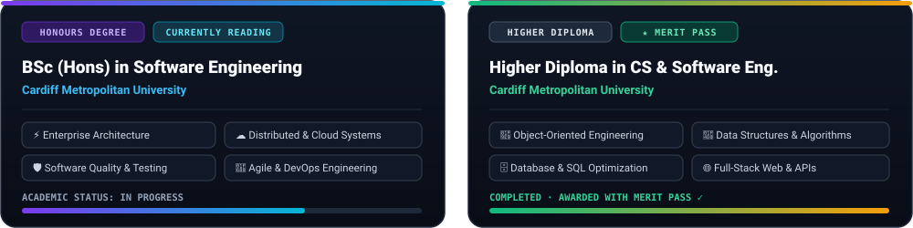

<div align="center">
  <a href="https://ywanigaarachchi.github.io/Y_N_W/">
    
  </a>
</div>

<br/>

<div align="center">
  <a href="https://linkedin.com/in/yasas-wanigaarachchi" target="_blank">
    
  </a>
  &nbsp;
  <a href="https://ywanigaarachchi.github.io/Y_N_W/" target="_blank">
    
  </a>
  &nbsp;
  <a href="mailto:ywanigaarachchi@gmail.com">
    
  </a>
  &nbsp;
  <a href="https://dev.to/ywanigaarachchi" target="_blank">
    
  </a>
  &nbsp;
  <a href="https://github.com/YWanigaarachchi?tab=followers">
    
  </a>
  &nbsp;
  
</div>

<br/>


<br/>

### `01 //` Developer Profile

```ts
const yasas: SoftwareEngineer = {
  name: "Yasas Nirmitha Wanigaarachchi",
  location: "Sri Lanka 🇱🇰",
  role: ["Full-Stack Software Engineer", "Cloud Solutions Architect"],
  education: {
    reading: "BSc (Hons) in Software Engineering",
    completed: "Higher Diploma in Computer Science & Software Engineering (Merit Pass 🏆)",
    university: "Cardiff Metropolitan University",
  },
  specialties: [
    "Enterprise Hospitality SaaS (HMS)",
    "Distributed Microservices & Event-Driven Systems",
    "AI / Retrieval-Augmented Generation (RAG) Workflows",
    "AWS Cloud Infrastructure & Automated CI/CD",
  ],
  engineeringEthos: "Clean Architecture · High Reliability · Elegant UX",
  availableForOpportunities: true,
};
```

<br/>


<br/>

### `02 //` Academic Journey & Credentials

<div align="center">
  
</div>

<br/>


<br/>

### `03 //` Technical Stack

<div align="center">

<sub><b>LANGUAGES</b></sub><br/>


<br/>

<sub><b>FRONTEND &amp; UI ENGINEERING</b></sub><br/>


<br/>

<sub><b>BACKEND, APIS &amp; AI</b></sub><br/>


<br/>

<sub><b>CLOUD, DEVOPS &amp; DATABASES</b></sub><br/>


<br/>


</div>

<br/>


<br/>

### `04 //` Selected Engineering Projects

| Project | Domain | Key Architecture & Highlights | Core Stack | Source |
| :--- | :--- | :--- | :--- | :---: |
| **🤖 ContextSync AI** | `AI / RAG` | Contextual vector search bridged with LLM agent orchestration & automated downstream workflows | `Python` `FastAPI` `LLMs` | [Repo ↗](https://github.com/YWanigaarachchi/ContextSync-AI) |
| **🏝️ Resortify HMS** | `Boutique SaaS` | Decoupled resort platform with real-time KOT, dual-currency (`LKR`/`USD`) sync & automated VAT/SSCL compliance | `React` `Node.js` `Tailwind` | [Repo ↗](https://github.com/YWanigaarachchi/Resortify-hms) |
| **🛎️ Siyala HMS** | `Enterprise HMS` | Multi-chain hotel management across Kandy & Hikkaduwa with inventory sync, procurement & analytics | `JavaScript` `HTML5` `CSS3` | [Repo ↗](https://github.com/YWanigaarachchi/Siyala_HMS1) |
| **🇱🇰 LankaRest HMS** | `Tourism Engine` | Modular tourism hospitality platform featuring tiered room management & dynamic seasonal pricing | `JavaScript` `HTML5` `CSS3` | [Repo ↗](https://github.com/YWanigaarachchi/lankarest-hms) |
| **🏨 Athithi HMS** | `Luxury Villas` | Streamlined guest check-in workflows, reservation engine, staff scheduling & inventory alerts | `JavaScript` `HTML5` `CSS3` | [Repo ↗](https://github.com/YWanigaarachchi/athithi-hms) |
| **🌿 GreenLife Wellness** | `HealthTech` | Digital wellness portal for yoga, clinical therapy & nutrition with online booking & therapist dashboards | `PHP` `JavaScript` `CSS3` | [Repo ↗](https://github.com/YWanigaarachchi/GreenLife_Wellness_Center) |

<br/>


<br/>

### `05 //` Live GitHub Telemetry

<div align="center">
  
  &nbsp;
  
</div>

<br/>

<div align="center">
  
  &nbsp;
  
</div>

<br/>

<div align="center">
  
</div>

<br/>

<details>
  <summary><b>🐍 View Contribution Activity Snake &amp; GitHub Trophies</b></summary>
  <br/>
  <div align="center">
    <picture>
      <source media="(prefers-color-scheme: dark)" srcset="https://raw.githubusercontent.com/YWanigaarachchi/YWanigaarachchi/output/github-contribution-grid-snake-dark.svg" />
      <source media="(prefers-color-scheme: light)" srcset="https://raw.githubusercontent.com/YWanigaarachchi/YWanigaarachchi/output/github-contribution-grid-snake.svg" />
      
    </picture>
    <br/><br/>
    
  </div>
</details>

<br/>


<br/>

### `06 //` Engineering Notes & Writings

<!-- BLOG-POST-LIST:START -->
- 🚀 *Upcoming deep-dives on Distributed Microservices, AWS Cloud Architecture, and Full-Stack Engineering — stay tuned!*
<!-- BLOG-POST-LIST:END -->

<sub><a href="https://dev.to/ywanigaarachchi"><b>Read all articles on Dev.to ↗</b></a></sub>

<br/><br/>

<div align="center">
  <a href="mailto:ywanigaarachchi@gmail.com">
    
  </a>
</div>
